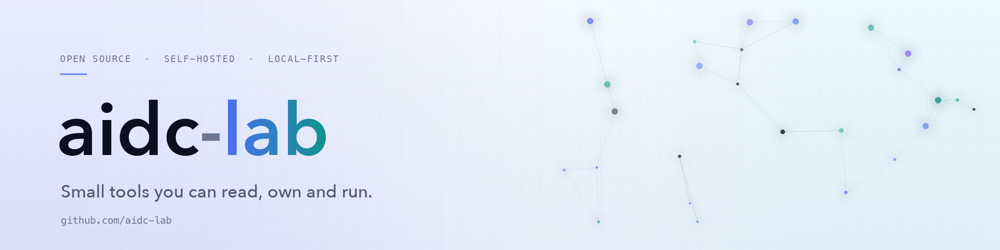

<picture>
  <source media="(prefers-color-scheme: dark)" srcset="https://raw.githubusercontent.com/aidc-lab/.github/main/profile/assets/banner-dark.png">
  <source media="(prefers-color-scheme: light)" srcset="https://raw.githubusercontent.com/aidc-lab/.github/main/profile/assets/banner-light.png">
  
</picture>

 

**Practical AI tooling, built in the open.**

Plugins for [DeepSeek Harness](https://github.com/deepseek-ai/DeepSeek-Harness), local-first AI apps and small self-hosted utilities — each one small enough to read, and yours to run.

**English** · [简体中文](https://github.com/aidc-lab/.github/blob/main/profile/README.zh-CN.md)

---

## What we build

- **🧩 DSH plugins** — [DeepSeek Harness](https://github.com/deepseek-ai/DeepSeek-Harness) is a desktop agent that gets better with plugins. We build them: a movie and TV workbench that searches TMDB, IMDb and Douban on one page.
- **🧠 Local-first AI** — apps that keep your data, your models and your keys on your own machine, with no account and no telemetry. [lumen](https://github.com/aidc-lab/lumen) turns a folder of course material into a private knowledge base you can search, practise from and ask cited questions.
- **🛠 Self-hosted utilities** — small Go and Vue tools that do one job well: a photo album that indexes WebDAV and Baidu Netdisk, a perler-bead canvas, a game engine.

## Featured projects

| Project | What it does | Stack |
| :------ | :----------- | :---- |
| **[dsh‑movie‑workbench](https://github.com/aidc-lab/dsh-movie-workbench)** | Searches movies and TV series across TMDB, IMDb and Douban on a single page, then hunts down BT resources with sortable seeds and magnet links. Installs straight from the DSH Plugins page. | `JavaScript` |
| **[lumen](https://github.com/aidc-lab/lumen)** | Local-first study and teaching companion: import course material, search it with hybrid full-text + vector retrieval, generate exercises, auto-grade quizzes and ask cited questions. | `Python` `TypeScript` |
| **[ialbum](https://github.com/aidc-lab/ialbum)** | Self-hosted private photo album. Indexes local paths, WebDAV and Baidu Netdisk, mirrors asynchronously to a backup store, and ships as a single Go binary with an embedded Vue UI. | `Go` `Vue` |
| **[PerlerBeads](https://github.com/aidc-lab/PerlerBeads)** | A browser workbench for perler-bead art: infinite grid, reference-image overlay, colour locking, auto-save and PNG template export. | `Go` `Vue` |
| **[texas](https://github.com/aidc-lab/texas)** | A small game engine, written in Go. | `Go` `Vue` |

## Also in the lab

| Repository | What it is |
| :--------- | :--------- |
| **[putting‑the‑you‑in‑cpu‑zh](https://github.com/aidc-lab/putting-the-you-in-cpu-zh)** | A Chinese translation of *Putting the "You" in CPU* — a guided tour of multitasking, syscalls, memory management and ELF loading. |
| **[awesome-dsh-plugin](https://github.com/aidc-lab/awesome-dsh-plugin)** | Our fork of the community-curated DSH plugin list — [awesome-dsh-plugin.com](https://awesome-dsh-plugin.com). |
| **[custom-openclaw](https://github.com/aidc-lab/custom-openclaw)** | A customized build of [OpenClaw](https://github.com/openclaw/openclaw), the personal AI assistant you run on your own devices. |
| **Forks we track** | [LlamaFactory](https://github.com/hiyouga/LlamaFactory), [ms-swift](https://github.com/modelscope/ms-swift) and [CloudCLI](https://github.com/siteboon/claudecodeui) — kept for experimentation; upstream is where the real work happens. |

## How we build

- **Local first.** Data, models and keys stay on your machine. No accounts, no cloud round-trips.
- **Small enough to read.** One binary where possible, assets embedded, dependencies kept few.
- **Boring where it counts.** SQLite, Go and standard web tech, so the interesting part is the product.
- **MIT by default.** Everything we own is MIT; forks keep their upstream licence.

## Contributing

Issues and pull requests are welcome on any repository. A bug report goes further with a reproduction, a version and a log; a feature idea is easier to act on when you describe the problem before the solution.

- Read [CONTRIBUTING.md](https://github.com/aidc-lab/.github/blob/main/CONTRIBUTING.md) before opening a PR.
- Found a vulnerability? Use [SECURITY.md](https://github.com/aidc-lab/.github/blob/main/SECURITY.md) rather than a public issue.
- Be decent to each other — see the [Code of Conduct](https://github.com/aidc-lab/.github/blob/main/CODE_OF_CONDUCT.md).

aidc-lab · open source, self-hosted, local-first
