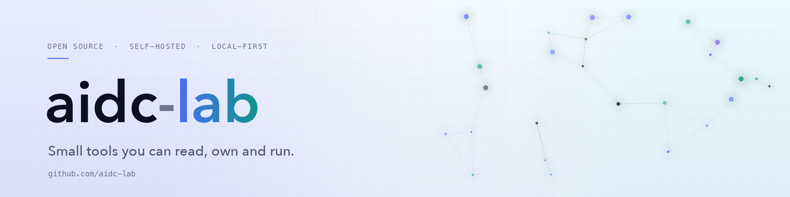

<picture>
  <source media="(prefers-color-scheme: dark)" srcset="https://raw.githubusercontent.com/aidc-lab/.github/main/profile/assets/banner-dark.png">
  <source media="(prefers-color-scheme: light)" srcset="https://raw.githubusercontent.com/aidc-lab/.github/main/profile/assets/banner-light.png">
  
</picture>

 

**让 AI 工具真正落在你自己手里。**

为 [DeepSeek Harness](https://github.com/deepseek-ai/DeepSeek-Harness) 写插件，做本地优先的 AI 应用，也打磨一些能自托管的小工具 —— 每一个都小到可以读完，并且能直接跑在你自己的机器上。

[English](https://github.com/aidc-lab/.github/blob/main/profile/README.md) · **简体中文**

---

## 我们在做什么

- **🧩 DSH 插件** —— [DeepSeek Harness](https://github.com/deepseek-ai/DeepSeek-Harness) 是一个靠插件变得更好用的桌面 Agent。我们给它写插件：一个把 TMDB、IMDb、豆瓣放在同一页的影视工作台。
- **🧠 本地优先的 AI** —— 数据、模型和密钥都留在你自己的机器上，不需要账号，也没有遥测。[lumen](https://github.com/aidc-lab/lumen) 会把你手头的课程资料变成私有知识库：能检索、能刷题、能追问，并附上引用来源。
- **🛠 自托管小工具** —— 用 Go 和 Vue 写的小工具，把一件事做到位：一个能索引 WebDAV 和百度网盘的相册、一块拼豆画布、一个游戏引擎。

## 主要项目

| 项目 | 它能做什么 | 技术栈 |
| :--- | :--------- | :----- |
| **[dsh‑movie‑workbench](https://github.com/aidc-lab/dsh-movie-workbench)** | 在同一个页面里搜索 TMDB、IMDb 和豆瓣的电影与剧集，再顺手找 BT 资源：种子、下载量可排序，磁力链接一键复制。在 DSH 的插件页面直接安装。 | `JavaScript` |
| **[lumen](https://github.com/aidc-lab/lumen)** | 本地优先的学习与教学助手：导入课程资料，用全文 + 向量的混合检索查内容、出练习题、自动判分，并就着出处追问。 | `Python` `TypeScript` |
| **[ialbum](https://github.com/aidc-lab/ialbum)** | 自托管的私人相册。索引本地路径、WebDAV 和百度网盘，异步镜像到备份存储，最终只有一个 Go 二进制和一个 Vue 前端。 | `Go` `Vue` |
| **[PerlerBeads](https://github.com/aidc-lab/PerlerBeads)** | 浏览器里的拼豆工作台：无限画布、参考图叠放、按颜色锁定、自动保存，以及 PNG 拼豆模板导出。 | `Go` `Vue` |
| **[texas](https://github.com/aidc-lab/texas)** | 一个用 Go 写的小型游戏引擎。 | `Go` `Vue` |

## 实验室里的其他东西

| 仓库 | 简介 |
| :--- | :--- |
| **[putting‑the‑you‑in‑cpu‑zh](https://github.com/aidc-lab/putting-the-you-in-cpu-zh)** | *Putting the "You" in CPU* 的中文翻译：从多任务、系统调用讲到内存管理和 ELF 加载。 |
| **[awesome-dsh-plugin](https://github.com/aidc-lab/awesome-dsh-plugin)** | 我们维护的 DSH 插件精选列表分支 —— [awesome-dsh-plugin.com](https://awesome-dsh-plugin.com)。 |
| **[custom-openclaw](https://github.com/aidc-lab/custom-openclaw)** | [OpenClaw](https://github.com/openclaw/openclaw) 的定制构建版：跑在自己设备上的个人 AI 助手。 |
| **持续跟进的上游** | [LlamaFactory](https://github.com/hiyouga/LlamaFactory)、[ms-swift](https://github.com/modelscope/ms-swift)、[CloudCLI](https://github.com/siteboon/claudecodeui) —— Fork 用于实验，真正的工作发生在上游。 |

## 我们怎么做事

- **本地优先。** 数据、模型、密钥都在你的机器上；不要账号，不走云端。
- **小到能读完。** 能单文件就单文件，静态资源内嵌，依赖越少越好。
- **该无聊的地方就无聊。** SQLite、Go 和标准 Web 技术 —— 把有意思的精力留给产品本身。
- **默认 MIT。** 我们自己的仓库一律 MIT；Fork 保留上游许可。

## 参与贡献

欢迎在任何仓库提 Issue 和 Pull Request。附上复现步骤、版本和日志的 Bug 报告最有用；讲清楚问题再讲方案，功能建议更容易被采纳。

- 提交 PR 前请先读 [CONTRIBUTING.md](https://github.com/aidc-lab/.github/blob/main/CONTRIBUTING.md)。
- 发现安全问题？请按 [SECURITY.md](https://github.com/aidc-lab/.github/blob/main/SECURITY.md) 私下反馈，不要开公开 Issue。
- 彼此友善一点 —— 见[行为准则](https://github.com/aidc-lab/.github/blob/main/CODE_OF_CONDUCT.md)。

aidc-lab · 开源 · 自托管 · 本地优先
